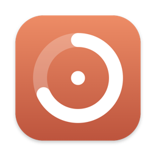
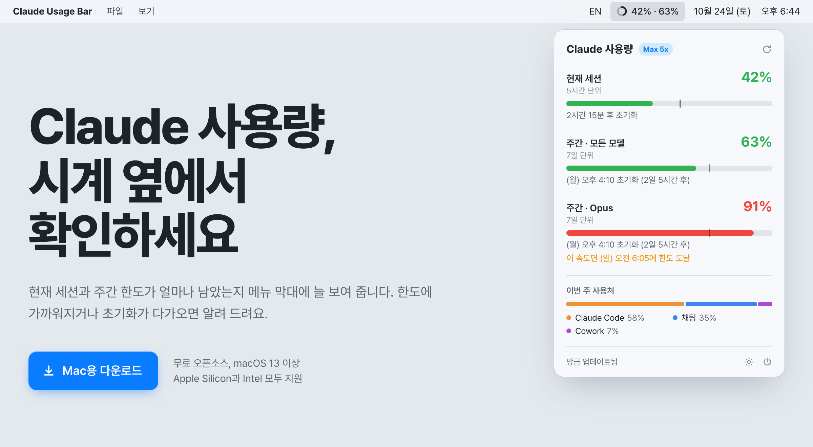
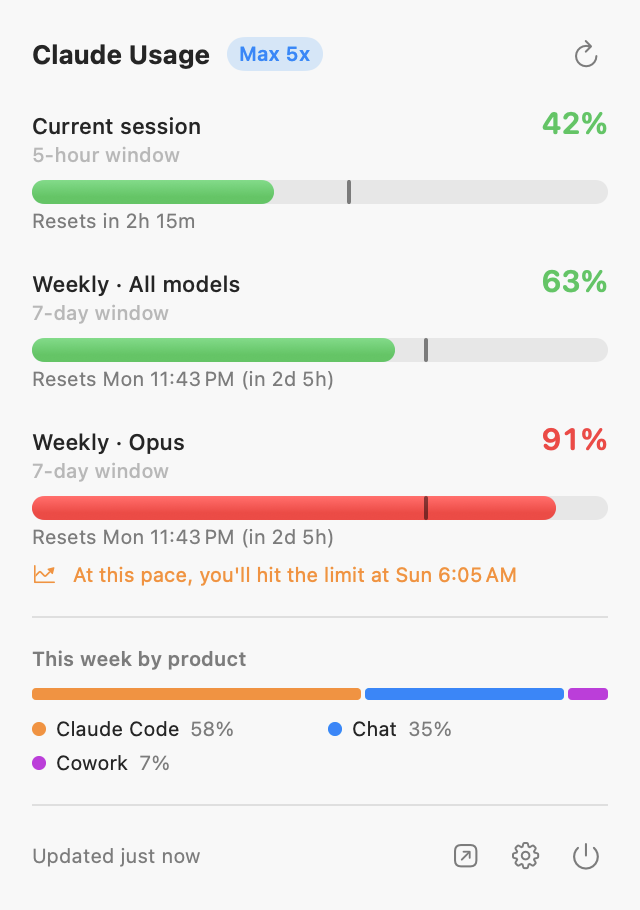
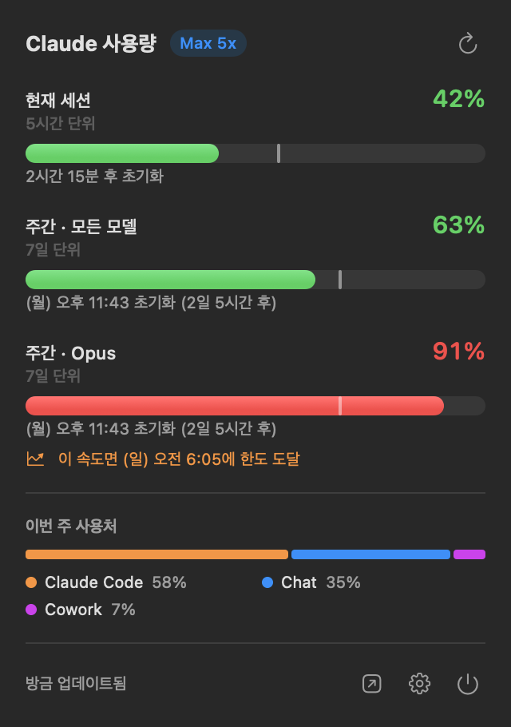

<div align="center">



# Claude Usage Bar

**Claude 사용량, 시계 옆에서 확인하세요.**<br>
macOS 메뉴 막대에 현재 세션과 주간 한도를 늘 띄워 두는 무료 오픈소스 앱

[](https://github.com/eocnd36/ClaudeUsageBar/releases/latest/download/ClaudeUsageBar.zip)
&nbsp;
[](https://eocnd36.github.io/ClaudeUsageBar/)

[](https://github.com/eocnd36/ClaudeUsageBar/actions/workflows/ci.yml)


[](LICENSE)

[English](#english) · [한국어](#한국어)

<picture>
  <source media="(prefers-color-scheme: dark)" srcset="docs/hero-dark.png">
  
</picture>

</div>

<a id="한국어"></a>

## 이런 앱이에요

|  |  |
| --- | --- |
| **메뉴 막대에 늘 표시** | 원형 게이지와 `42% · 63%`(세션 · 주간)를 시계 옆에 띄워 둡니다. 90%를 넘으면 게이지가 빨간색으로 바뀌어요. |
| **한눈에 보는 상세 화면** | 5시간 세션, 주간 한도(모든 모델, 플랜에 따라 Opus · Sonnet), 초기화까지 남은 시간, 이번 주 사용처(Claude Code, 채팅, Cowork) |
| **페이스 눈금** | 막대 위 세로선은 한도 기간 중 지나간 시간이에요. 막대가 눈금보다 앞서 있으면 평소보다 빨리 쓰고 있다는 뜻입니다. |
| **한도 도달 예측** | 지금 속도로 쓰면 언제 한도에 닿는지 미리 보여 줘요. "이 속도면 오후 3:20에 한도 도달" |
| **내 맘대로 알림** | 알림 받을 사용률(기본 80%, 95%)과 초기화 몇 분 전에 알릴지 직접 입력해요. 한도가 다시 채워지는 순간에도 알려 드릴 수 있어요. |
| **Claude 장애 알림** | 공식 상태 페이지(status.claude.com)에 장애가 올라오면 배너와 알림으로 알려 줘요. 내 문제인지 Claude 문제인지 바로 알 수 있습니다. |
| **연결과 연결 해제** | 직접 "연결"을 눌러야 계정이 연결되고, 설정에서 언제든 연결을 해제할 수 있어요. 해제하면 앱에 있던 데이터를 모두 지웁니다. |
| **11개 언어** | English, 한국어, 日本語, 简体中文, 繁體中文, Español, Français, Deutsch, Italiano, Português (Brasil), Русский |
| **가볍게** | Dock 아이콘 없이 메뉴 막대에서만 동작하고, 외부 라이브러리 없이 2.5MB 정도입니다. 라이트 · 다크 모드를 지원해요. |

<p align="center">
  
  &nbsp;&nbsp;
  
</p>

## 설치

> 필요한 것: **macOS 13 이상**, 그리고 Claude 구독(Pro · Max · Team) 계정으로 로그인된 **[Claude Code](https://docs.claude.com/en/docs/claude-code/setup)**

1. **[ClaudeUsageBar.zip 내려받기](https://github.com/eocnd36/ClaudeUsageBar/releases/latest/download/ClaudeUsageBar.zip)** → 압축을 풀고 `응용 프로그램` 폴더로 옮깁니다.
2. 처음 열 때 "확인되지 않은 개발자" 경고가 뜨면 **시스템 설정 → 개인정보 보호 및 보안 → 그래도 열기**를 누르거나 아래 명령을 실행하세요.
   ```sh
   xattr -dr com.apple.quarantine "/Applications/Claude Usage Bar.app"
   ```
   Apple 공증을 받지 않은 오픈소스 빌드라서 나오는 경고입니다.
3. 메뉴 막대의 게이지를 클릭하고 **연결**을 누르면 끝이에요.

사용 한도는 claude.ai, 데스크톱 앱, Claude Code가 함께 쓰기 때문에 여기 보이는 수치가 전체 사용량입니다.

## 개인정보

- **Anthropic으로만 전송**: 로그인 토큰은 사용량을 불러올 때 `api.anthropic.com`에만 보냅니다. 그 밖에는 계정 정보 없이 공개 상태 페이지(`status.claude.com`)만 확인하고, 분석 도구는 쓰지 않아요.
- **읽기만 합니다**: Claude Code가 키체인에 저장한 로그인을 읽기만 하고 바꾸지 않아서, Claude Code에는 아무 영향이 없습니다.
- **저장하지 않습니다**: 사용량과 계정 정보는 메모리에만 두고, 연결을 해제하면 바로 지웁니다.

<details>
<summary><b>왜 앱 안에서 Claude에 직접 로그인하지 않나요?</b></summary>

Claude 구독 계정의 OAuth 로그인은 Anthropic 공식 앱(Claude Code, claude.ai)에만 허용됩니다. 서드파티 앱이 Claude Code를 흉내 내 직접 로그인하면 계정이 제재될 위험이 있어서, 이 앱은 이미 해 둔 Claude Code 로그인을 읽기 전용으로만 씁니다. Claude Code에서 로그아웃하려면 터미널에서 `claude`를 실행하고 `/logout`을 입력하세요.
</details>

<details>
<summary><b>작동 방식</b></summary>

1. **연결**을 누르면 `security find-generic-password -s "Claude Code-credentials"`로 Claude Code의 OAuth 토큰을 읽습니다. 키체인에 없으면 `~/.claude/.credentials.json`에서 찾아요.
2. `GET https://api.anthropic.com/api/oauth/usage`(사용량)와 `/api/oauth/profile`(계정 이름 · 이메일)을 호출합니다. Claude Code의 `/usage`와 같은 데이터예요.
3. 기본 5분 간격으로 새로 불러오고, 팝오버를 열 때와 잠자기에서 깨어날 때도 갱신합니다.
</details>

## 문제 해결

| 이런 메시지가 뜨면 | 이렇게 하세요 |
| --- | --- |
| Claude Code 로그인 정보가 없어요 | 터미널에서 `claude`를 실행해 로그인하세요. |
| 로그인이 만료됐어요 | Claude Code 토큰은 몇 시간마다 만료돼요. 터미널에서 `claude`를 한 번 실행하면 갱신되고, 앱은 다음 새로고침 때 자동으로 복구됩니다. |
| 요청이 너무 많아요 | 몇 분 뒤 자동으로 다시 시도해요. 새로고침 간격을 늘려 보세요. |
| 예상하지 못한 응답 | 비공개 API라 형식이 바뀌었을 수 있어요. [이슈](https://github.com/eocnd36/ClaudeUsageBar/issues)로 알려 주세요. |

## 개발

Xcode 16 이상 또는 Command Line Tools(Swift 6)가 필요합니다.

```sh
make run         # .app 빌드 후 실행
make install     # /Applications에 설치
make test        # 번역 검사 + 단위 테스트
make universal   # Apple silicon + Intel 유니버설 빌드 → dist/
make snapshot    # README 스크린샷 다시 만들기 (데모 데이터)
```

```
Sources/ClaudeUsageCore/   UI 없는 로직: API 모델, 인증 정보, 포맷팅, 알림 계획 (테스트 대상)
Sources/ClaudeUsageBar/    SwiftUI MenuBarExtra 앱
Resources/                 번역(11개 언어), 앱 아이콘
site/                      다운로드 웹사이트 (GitHub Pages)
scripts/                   .app 패키징, 아이콘 생성, 번역 검사
```

**릴리스**: `git tag v1.2.3 && git push origin v1.2.3` 하면 GitHub Actions가 테스트하고, 유니버설 앱을 빌드해 Release에 올립니다. 웹사이트의 다운로드 버튼은 항상 최신 릴리스를 가리켜요.

**번역 추가**: `Resources/<언어>.lproj/Localizable.strings`를 고치고(키는 코드의 영어 문장), 새 언어라면 `AppLanguage.supported`에도 추가한 뒤 `make l10n`으로 확인하세요.

---

<a id="english"></a>

## English

**Claude Usage Bar** keeps your Claude plan limits in the Mac menu bar, right next to the clock.

- **Always visible.** A ring gauge with `session% · weekly%` that turns red past 90%.
- **Detail at a click.** The 5-hour session, weekly limits (all models, plus Opus and Sonnet on some plans), reset countdowns, and this week's split by product.
- **Pace marker.** A tick shows how much of the window has passed. If the bar is ahead of the tick, you're using Claude faster than usual.
- **Limit projection.** See when you'll hit a limit at your current pace.
- **Alerts your way.** Choose the percentages that trigger alerts, how many minutes before a reset you want a reminder, and whether to be notified the moment a limit refills.
- **Outage alerts.** Get a banner and notification when status.claude.com reports a Claude incident.
- **Connect and disconnect.** Nothing is read until you press Connect. Disconnect anytime in Settings to clear all data from the app.
- **11 languages.** Follows your system language, or pick one in Settings.

### Install

You need macOS 13 or later and [Claude Code](https://docs.claude.com/en/docs/claude-code/setup) signed in with a Pro, Max or Team plan.

1. **[Download ClaudeUsageBar.zip](https://github.com/eocnd36/ClaudeUsageBar/releases/latest/download/ClaudeUsageBar.zip)**, unzip it, and move it to Applications.
2. If macOS blocks the first launch, choose *System Settings → Privacy & Security → Open Anyway*, or run `xattr -dr com.apple.quarantine "/Applications/Claude Usage Bar.app"`. The build isn't notarized by Apple.
3. Click the gauge in the menu bar and press **Connect**.

### Privacy

The app reads the OAuth token Claude Code keeps in your Keychain. It never changes that token, so Claude Code keeps working as before. The token is only sent to `api.anthropic.com`, which returns the same data as Claude Code's `/usage`. The only other request is to the public status page `status.claude.com`, with no account data. Usage and account data stay in memory, and Disconnect clears them.

---

<sub>Unofficial project, not affiliated with Anthropic. Claude is a trademark of Anthropic. It relies on an undocumented API that may change without notice. [MIT License](LICENSE).</sub>
